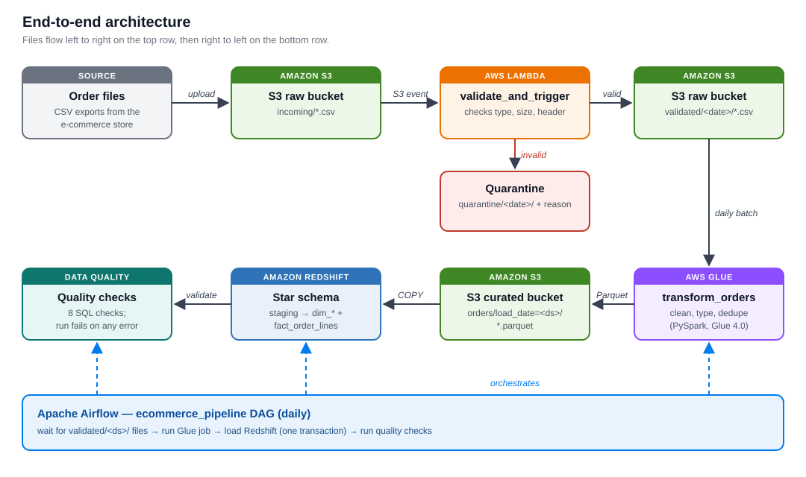
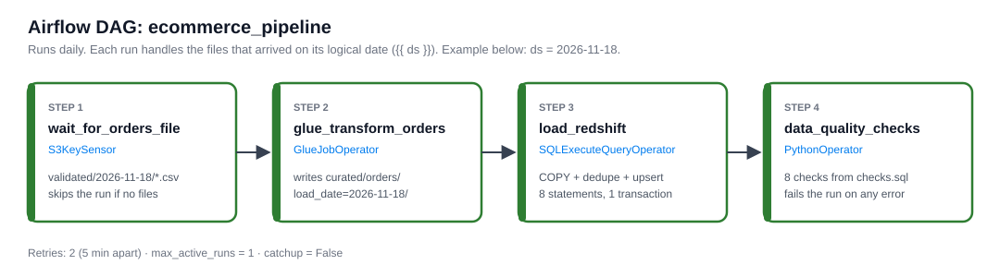
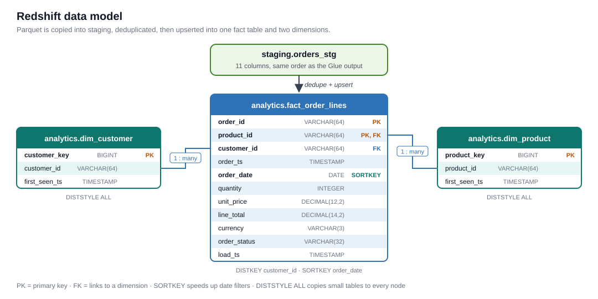
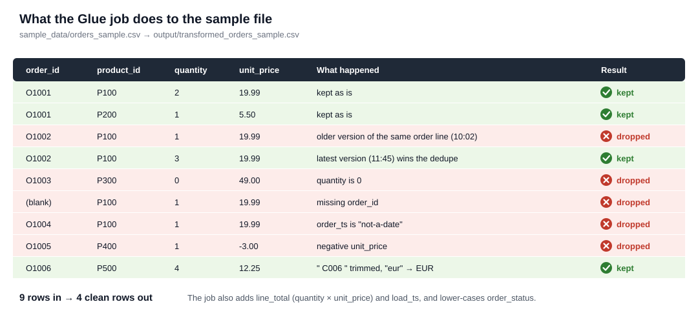

# AWS E-commerce Data Pipeline

Batch pipeline that validates raw order files, transforms them with Glue (PySpark),
loads a Redshift star schema, and runs data quality checks, orchestrated by Airflow.
Infrastructure is defined in Terraform.

## Architecture



### Design decisions
- **One trigger path.** The Lambda only validates and routes files; Airflow is the only thing
  that starts Glue. So each file is processed once.
- **Batches by arrival date.** Files are grouped by the day they arrived, not by the order date
  inside them, so late or back-dated orders are never skipped.
- **Idempotent re-runs.** Glue overwrites `load_date=<ds>/`, and Redshift upserts with
  delete + insert in a single transaction, so re-running a day gives the same result.
- **Dedup twice.** Glue keeps the latest version of each `(order_id, product_id)`. The load SQL
  dedupes staging again before it touches the fact table.

### Airflow DAG



### Redshift data model



## Project layout

| Path | Purpose |
|------|---------|
| `lambda/validate_and_trigger.py` | Validates CSVs (extension, size, header) and routes them to `validated/` or `quarantine/` |
| `glue/transform_orders.py` | Cleans, types, dedupes; writes Parquet in staging column order |
| `sql/redshift_schema.sql` | Staging, dimension and fact table DDL |
| `sql/load_redshift.sql` | COPY + dedupe + upsert (one transaction) |
| `quality/checks.sql` | DQ queries; each returns a failing-row count |
| `dags/ecommerce_pipeline_dag.py` | Airflow orchestration |
| `iam/*.json` | Least-privilege IAM policies (Terraform fills `${...}` placeholders) |
| `terraform/` | S3, Lambda + trigger, Glue job, IAM, Redshift Serverless |
| `sample_data/` | Sample good/bad files for testing |
| `docs/` | README diagrams and the script that generates them |
| `output/` | Real results from running the pipeline code on the sample data |
| `tests/` | pytest: Lambda (moto), Glue transform (local Spark), SQL checks, DAG |

## Input format (CSV)

`order_id, order_ts, customer_id, product_id, quantity, unit_price, currency, order_status`

## Deploy

```bash
# 1. Infrastructure
cd terraform
cp terraform.tfvars.example terraform.tfvars    # set redshift_admin_password
terraform init && terraform apply
terraform output                                # values for .env / Airflow

# 2. Redshift tables: run sql/redshift_schema.sql in the Redshift query editor

# 3. Airflow (MWAA or self-hosted)
#    - pip install -r requirements.txt
#    - copy dags/, sql/ and quality/ side by side into the DAGs folder
#    - connections: aws_default, redshift_default
#    - env vars from .env.example (values from terraform output)
#    - attach the airflow_policy_arn output to the MWAA execution role

# 4. Test it
aws s3 cp sample_data/orders_sample.csv s3://<raw_bucket>/incoming/
#    -> moved to validated/<today>/ ; the next day's DAG run processes it
#    (or trigger the DAG manually with logical date = today)
```

## Run tests locally

```bash
pip install -r requirements-dev.txt     # pyspark needs Java 8/11/17
pytest -v
```
`tests/test_dag.py` is skipped unless Airflow is installed.

## Data quality checks

Empty staging, null keys, duplicate order lines, non-positive quantity, line-total mismatch,
future-dated orders, and orphan customer/product keys.

## Sample output



See [`output/`](output/) for the full results: test runs, the Lambda routing log, and the
transformed CSV.

## Regenerate this project

```bash
python setup_project.py
```
